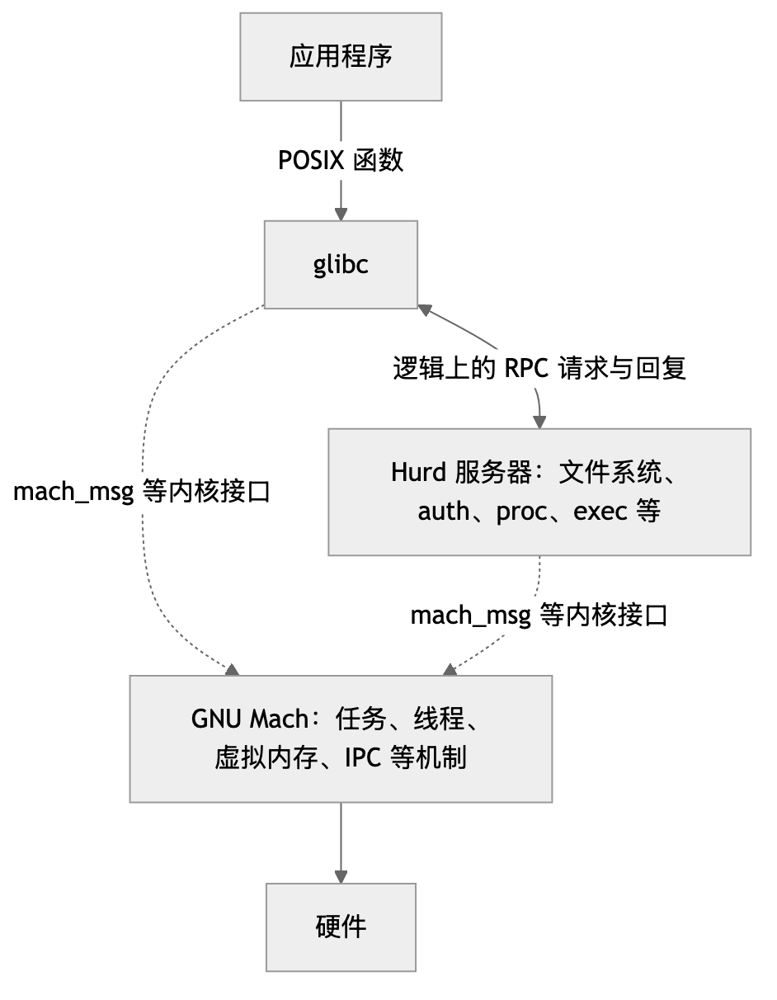

# GNU Hurd 学习资料库

面向有计算机本科基础、希望理解 GNU 微内核尝试的学习者。整理与来源核对日期：**2026-10-08**。

## 从这里开始

[返回项目入口](../README.md) · [中文导读](guides/README.md) · [代码实验](labs/README.md)

1. 按 [学习参考路线](guides/study-plan.md) 安排阅读和实验。
2. 运行 [三个 POSIX 代码实验](labs/posix/README.md)，观察机制和边界。
3. 阅读 [Hurd/Mach 导读](guides/learning-guide.md) 和 [seL4 学习路线](guides/sel4-learning.md) 的对应阶段。
4. 用 [微内核对照](guides/microkernel-comparison.md) 比较 Mach 历史选择与现代设计问题。

挑选论文时先看 [带注释的文献目录](guides/bibliography.md)；原始资料和出处见 [SOURCES.md](SOURCES.md)。

## 先建立一个准确的概念

Hurd 是一组实现文件系统、认证、进程管理等服务的用户态服务器；GNU Mach 是它下面的微内核。Mach 最初由 CMU 开发，GNU 后来维护 GNU Mach。MIG 根据接口定义生成 RPC 代码，glibc 则把程序使用的许多 POSIX 接口映射到这些服务。

[图表源码](assets/images/hurd-architecture.mmd)

图中的 RPC 通过 Mach IPC 传输。服务器与客户端通常运行在不同的地址空间中。

Hurd 值得研究的部分不仅是“把服务放到用户态”，还包括**可由普通用户扩展的命名空间、translator 的组合，以及相互不信任的程序如何协作**。驱动所在位置取决于具体构建和版本；早期系统包含内核驱动，近年的 rump 驱动工作推进了用户态驱动支持。

## 资料组织

| 位置 | 内容 |
| --- | --- |
| [guides/](guides/README.md) | 中文学习路线、机制对照与文献注释 |
| [labs/](labs/README.md) | 实验说明、C 源码和构建文件 |
| [papers/](papers/) | Hurd、Mach、L4/seL4 论文原文，保留 PDF 或 PostScript |
| [references/](references/) | GNU Mach、seL4 手册与 Hurd Hacking Guide |
| [sources/](sources/) | 官方文档快照、历史示例、网页索引和来源元数据 |
| [talks/](talks/) | FOSDEM 2026 进展报告和已有的 GNU Hurd Workshop 讲义 |
| [assets/images/](assets/images/) | Markdown 使用的 PNG 与 Mermaid 图表源码 |
| [SOURCES.md](SOURCES.md) | 原始资料的本地路径与在线来源 |
| [sources-manifest.json](sources-manifest.json) | 获取日期、版本、状态、大小与 SHA-256 |
| [references.bib](references.bib) | 精选 BibTeX 文献条目 |

资料收集核对日期为 2026-10-08；目录整理日期为 2026-10-09。各实验的程序和调试文件由构建过程生成在 `labs/posix/build/`。

官方 Wiki 原文保留 `.mdwn` 格式，其中的 `[[...]]` 是 ikiwiki 语法；用文本编辑器阅读即可。`hurd-paper.html`、`hurd-talk.html` 是版本库保留的历史文件名，内容也含 Wiki 指令。在线排版版入口见 [SOURCES.md](SOURCES.md)。

## 阅读时区分三个时间层次

- **早期设计**：Bushnell 的文章、Mach 论文与 2002 年 Hacking Guide 用来理解设计动机和机制。文中部分功能是当时的计划。
- **2007 年的反思**：Critique 和 position paper 是设计分析与研究提案。它们不直接说明某个问题在 2026 年是否仍未解决。
- **近期实现**：FOSDEM 2026 报告讨论 rump 驱动、x86_64、SMP、Rust 支持和发行版构建。安装时优先核对 [Debian GNU/Hurd 入口](https://www.debian.org/ports/hurd/) 及当前镜像说明。

本地 GNU Mach 手册为 Edition 0.4，2008-11-13 更新，对应 1.3.99；Hacking Guide 标示 Version 0.2_1，2002-03-25。两者可查机制和接口，具体 API 与构建细节需要对照当前源码。

## 来源与完整性

GNU Hurd Wiki 快照固定在官方 `hurd/web.git` 的提交 `0b50b37e0d8dda535346ef0cd66a54cf8cada672`（2026-10-02）。论文优先来自作者、大学档案或项目网站；部分出版信息用 Crossref DOI 记录核对。

下载文件经过格式与解析检查，原始文件不作翻译或改写，原有署名和许可保留。少数无法取得原文的资料在目录中明确标为“仅链接”，不会把错误页当论文保存。中文导读是对资料的学习建议，不是原文翻译。
